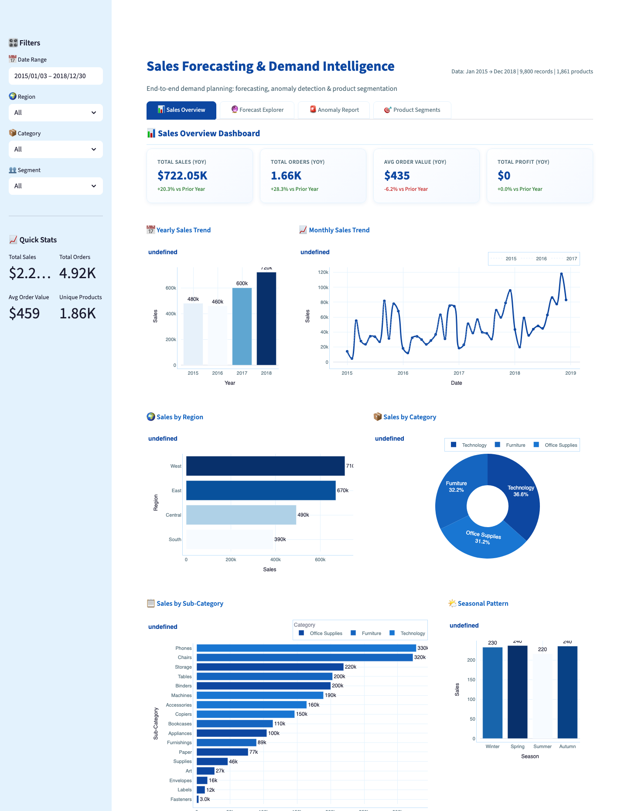
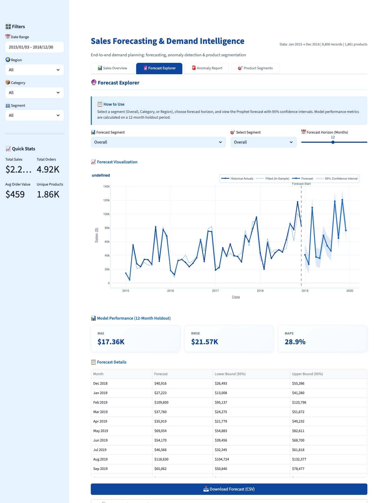

# Sales Forecasting & Demand Intelligence

An interactive analytics application for turning retail sales history into practical demand-planning decisions. The dashboard combines sales performance analysis, time-series forecasting, anomaly detection, and product demand segmentation in one Streamlit experience.

[Open the live dashboard](https://salesforecastingankitweek3-4internshipproject.streamlit.app/)

## Dashboard preview





## What this project delivers

- **Sales overview:** year-over-year KPIs and interactive trends by month, region, category, sub-category, and season.
- **Forecast explorer:** Prophet forecasts for overall sales, categories, or regions, with a configurable 1–24 month horizon and 95% confidence intervals.
- **Model evaluation:** MAE, RMSE, and MAPE on a 12-month holdout period.
- **Anomaly report:** unusual weekly sales patterns identified using both Isolation Forest and a rolling Z-score method.
- **Product segmentation:** K-Means clustering of sub-categories using sales volume, volatility, average order value, and year-over-year growth; PCA provides a two-dimensional view of the clusters.
- **Actionable outputs:** contextual anomaly interpretation, stocking recommendations for each demand segment, and CSV downloads for filtered data, forecasts, anomalies, and segments.

## Methods used

| Business question | Approach |
| --- | --- |
| How is sales performance changing? | Time-based aggregations and Plotly visualizations |
| What demand is expected next? | Facebook Prophet with yearly seasonality and 95% prediction intervals |
| Which weeks need investigation? | Isolation Forest plus a 4-week rolling Z-score (±2σ) |
| Which products need different inventory policies? | Standardized K-Means clustering (`k=4`) and PCA visualization |

## Tech stack

Python · Streamlit · Pandas · NumPy · Plotly · Prophet · scikit-learn

## Dataset

The app uses the included `train.csv` retail sales dataset. It contains 9,800 transaction records across 1,861 products, covering January 2015 through December 2018. The application derives date, season, and shipping-duration features before analysis.

## Run locally

```bash
git clone <your-repository-url>
cd SalesForecasting_AnkitKumar
python -m venv .venv
source .venv/bin/activate  # Windows: .venv\Scripts\activate
pip install -r requirements.txt
streamlit run app.py
```

Open `http://localhost:8501` when Streamlit starts.

## Project structure

```text
├── app.py                         # Streamlit dashboard and analytics workflow
├── analysis.ipynb                 # Exploratory analysis
├── train.csv                      # Retail sales dataset
├── requirements.txt               # Python dependencies
├── summary_sales.pdf              # Supporting sales summary
└── docs/images/
    ├── streamlit-dashboard.png    # Sales Overview screenshot
    └── forecast-explorer.png      # Forecast Explorer screenshot
```

## Deployment

The app is deployed with Streamlit Community Cloud:

<https://salesforecastingankitweek3-4internshipproject.streamlit.app/>

---

Internship Project — Week 3 & 4
